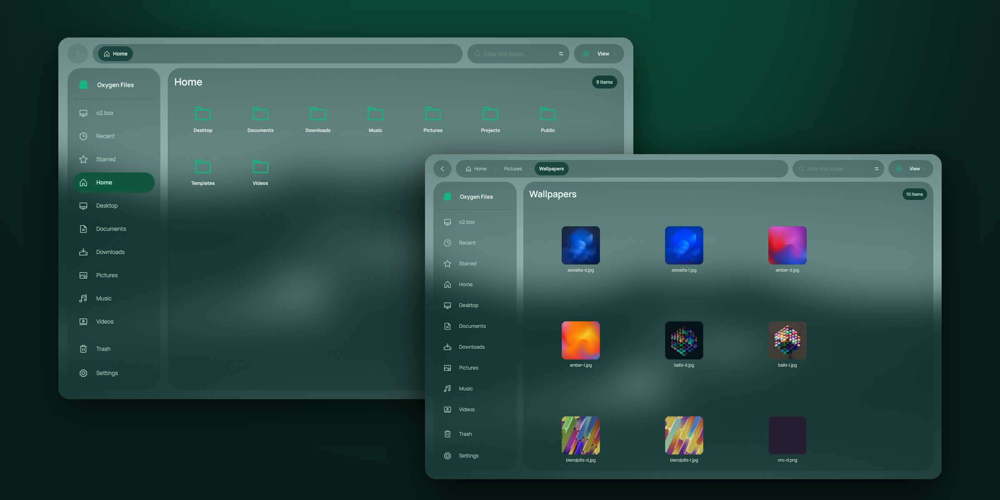
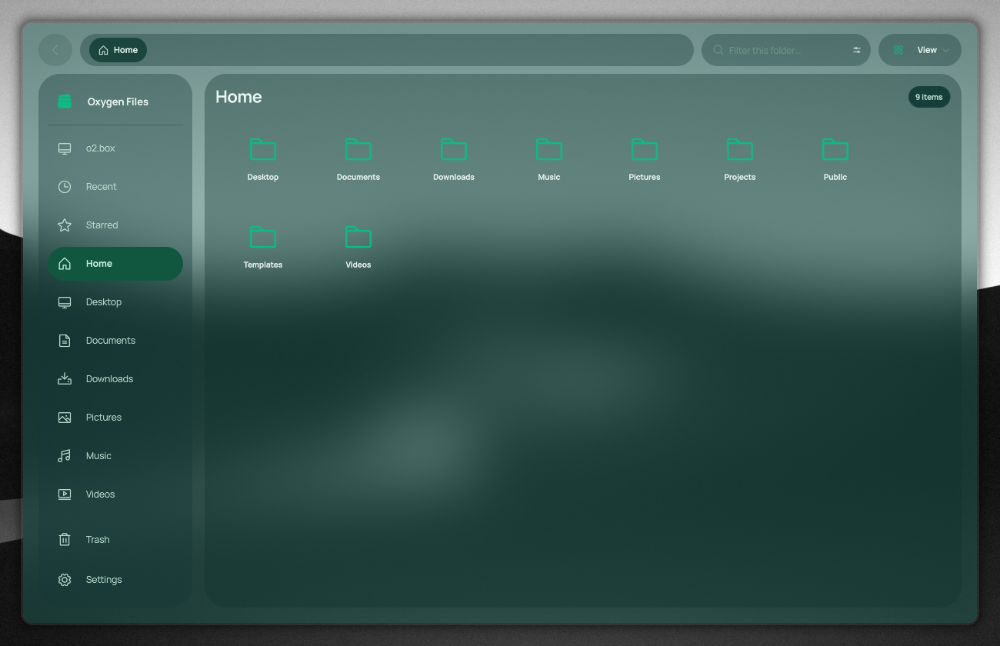
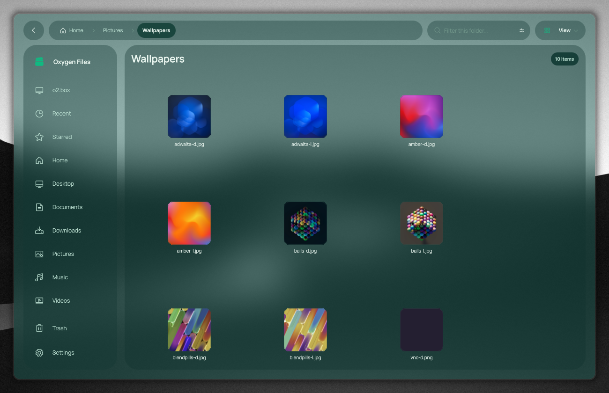

<p align="center">
  
</p>

<h1 align="center">Oxygen Files</h1>

<p align="center">
  A glassy file manager for Hyprland and the Unia family.<br>
  A fork of <a href="https://github.com/m-uvex/loaf-fm">Loaf</a> by m_uvex, dressed for <a href="https://github.com/BaraniukConnection/unia-breathe-desktop">Unia Breathe Desktop</a>.
</p>

<p align="center">
  
</p>

**Built with:** Rust + Qt 6 Quick / QML · **Runs on:** Linux, best on Hyprland · **Upstream:** [m-uvex/loaf-fm](https://github.com/m-uvex/loaf-fm) `dev` · **License:** MIT

---

## Why Oxygen Files

- **Glass that matches the desktop.** The window and its panels are translucent and Hyprland blurs what is behind them, the same deep emerald glass as Unia Breathe Desktop. Turn blur off and the window goes solid.
- **Everything Loaf already does well.** Fast folders, tabs and split view, archives, undo for every file operation, thumbnails, search. Oxygen Files keeps all of it and tracks Loaf's `dev` branch.
- **Your folders, your icons.** Give any folder, sidebar place or disk its own icon from the system theme, Simple Icons, Material Symbols, emoji, your own icon sets, or any image.
- **Fixes that go back upstream.** Bugs found here are written up for Loaf, so both projects get them.

## Features

### From Loaf
- **Material 3 Expressive** motion and eight colour palettes, plus one generated from your wallpaper
- **Tabs** (`Ctrl+T`) and **split view** (`F3`), restored on the next start
- **Archives:** compress and extract `.zip` (also with a password), `.tar.gz`, `.7z`, `.tar.xz`, `.tar.zst`, `.tar.bz2`, `.cpio`
- **Undo and redo** (`Ctrl+Z` / `Ctrl+Y`) for renames, new files, moves and deletions
- **Background operations** with a progress pill, cancel and undo; removable drives are flushed before they report done
- **Thumbnails** for images, videos, PDFs and fonts through the shared freedesktop cache
- **Search** as you type, or through subfolders and your whole home folder, optionally inside text files
- **Live folders** that update the moment another program changes them
- **Desktop integration:** GTK bookmarks, Recent and Starred, Open With, templates, Nautilus scripts, freedesktop trash, Open as Administrator
- **Low-power mode** that turns effects off on machines without GPU acceleration

### Added in Oxygen Files
- **The Unia palette** as the default: dark from the shell, light from Vision DesignSystem
- **Frosted glass** with four levels (Off · Low · Medium · Unia) in Settings → Interface → Transparency. Menus and dialogs stay solid
- **Follows the compositor's blur:** while blur is off in Hyprland, the window is solid instead of see-through
- **Disks** on the This PC page: a card per drive with its free and used space; click to open or mount, right-click for the disk menu
- **Custom icons** for folders, sidebar places and disks (right-click → Change Icon…)
- **Manrope** as the interface face and the Oxygen Files mark from Vision DesignSystem
- **Fixes:** disks are read at startup, dragging in Customize Sidebar works, submenus open beside their menu, the View menu opens under its button

## Screenshots

| Home | Pictures |
|:-:|:-:|
|  |  |

## Install

Oxygen Files is built against your system's Qt 6. On Fedora:

```bash
sudo dnf install cargo rust cmake ninja-build gcc-c++ pkgconf-pkg-config \
  qt6-qtbase-devel qt6-qtbase-private-devel qt6-qtdeclarative-devel qt6-qtsvg-devel qt6-qtwayland-devel
git clone https://github.com/BaraniukConnection/OxygenFiles
cd OxygenFiles
./install.sh        # builds if needed; installs the oxygen-files command and an "Oxygen Files" menu entry
```

`./build.sh` rebuilds after changes; the QML is compiled into the binary (`target/release/loaf`).

Loaf's ready packages (tarball, .deb, .pkg, AppImage) are built against a non-system Qt or a newer glibc and do not start on Fedora 44, so Oxygen Files builds from source.

For the glass, Hyprland needs blur on (`decoration:blur:enabled`, on by default). [Unia Breathe Desktop](https://github.com/BaraniukConnection/unia-breathe-desktop) sets everything up.

## Under the hood

- **Rust** for listing, file operations, archives, drives and search; **Qt 6 Quick / QML** for the interface; a little **C++** for Qt glue
- `qml/Theme.qml` holds the palettes and tokens; `qml/main.qml` the window; `src/` the core; `cpp/native.cpp` turns on the alpha buffer that lets Hyprland blur behind the window
- `src/theme.rs` asks Hyprland over its socket whether blur is on, every two seconds

## Upstream

This repository is a GitHub fork of [m-uvex/loaf-fm](https://github.com/m-uvex/loaf-fm), made with the author's agreement. It builds on the `dev` branch, where the author merges all changes; [`UPSTREAM`](UPSTREAM) records the commit it is based on, and Loaf's own README is kept as [`UPSTREAM-README.md`](UPSTREAM-README.md).

The fork leaves out Loaf's release binaries, packaging recipes and CI, and builds from source instead.

### Fixes worth sending to Loaf

Each was found on `dev` 8877dc1. Before opening a pull request, check that nobody has fixed it there already.

- **Disks are not read at startup.** `drives_json` starts as `"[]"`, and `load_drives()` runs only when the DeviceWatcher (`src/watcher.rs`) sees a device or mount change, or after a disk action. Until then This PC shows no disks at all. The fix is one call to `self.as_mut().load_drives();` in `initialize()` in `src/core.rs`.
- **Dragging in Customize Sidebar does not work.** The ListView takes the motion for scrolling (no `preventStealing`), and every `move_place` rebuilds the model and destroys the row under the mouse. The fix is a ListModel with a live `move()`, saving the order on release (`qml/main.qml`, `customizePlaces`).
- **A submenu covers its menu** when there is no room on the right: `LoafPopup.reposition()` shifts it onto the parent menu. The fix flips it to the left of the row (`flipRightEdge`, `openRightOf`).
- **The View menu drifts sideways:** its position is measured from the arrow's MouseArea instead of `viewDropdownButton` in `qml/main.qml`.

## License

Loaf is released under the MIT License, as its README states, and Oxygen Files keeps that license for its changes too.

| | License |
|---|---|
| [Loaf](https://github.com/m-uvex/loaf-fm) | MIT |
| [Manrope](https://github.com/sharanda/manrope) | SIL Open Font License 1.1 |
| [Material Symbols](https://github.com/google/material-design-icons) | Apache License 2.0 |
| [Phosphor Icons](https://phosphoricons.com) | MIT |
| [Simple Icons](https://simpleicons.org) | CC0 1.0 |
